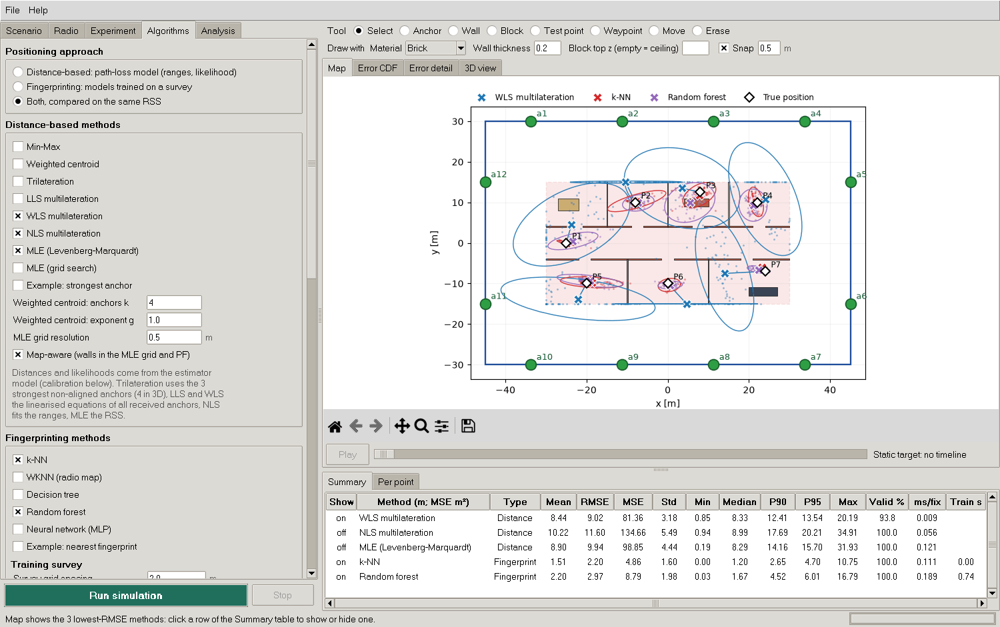
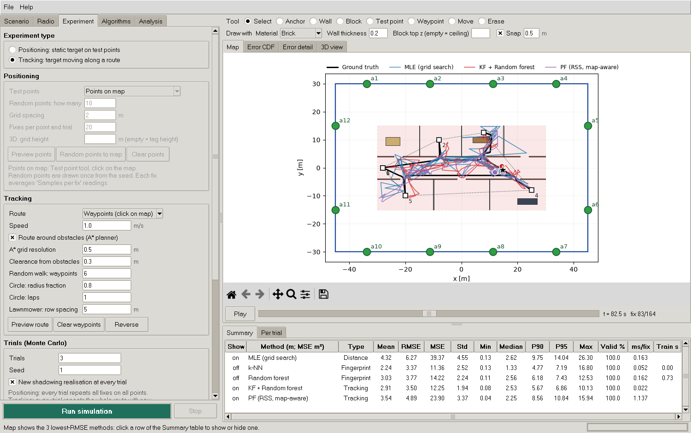
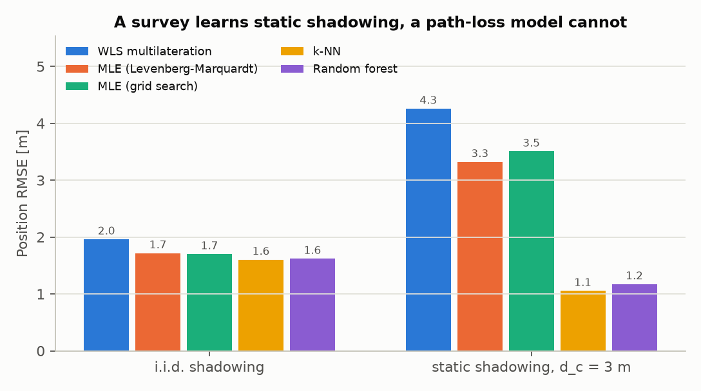

# RSSILab Indoor Positioning Simulator


[](LICENSE)

**RSSILab Indoor Positioning Simulator** (RSSILab for short) is a simulator for
research on GPS-free indoor positioning and tracking based on the received signal
strength (RSS / RSSI). It lets you build an indoor scenario (room, anchors, walls and
furniture with their materials and heights), choose a radio technology, generate RSS
datasets and evaluate positioning and tracking algorithms with Monte Carlo trials and
detailed error statistics. Two families of methods can be compared on exactly the
same RSS: **distance-based** methods, which invert a path-loss model (trilateration,
LLS / WLS / NLS multilateration, maximum likelihood), and **fingerprinting** models
(k-NN, decision tree, random forest, neural network) trained on a simulated survey of
the scenario at the resolution you choose. Your own methods plug in as well.

RSSILab is a desktop application (Tkinter + Matplotlib) and a Python package that
can be scripted from notebooks and batch experiments. It depends on NumPy,
Matplotlib and scikit-learn.



## Contents

- [Documentation](#documentation): index of all the guides
- [Features](#features)
- [Installation](#installation)
- [Quick start](#quick-start)
- [Repository layout](#repository-layout)
- [Validation](#validation)
- [Citing RSSILab](#citing-rssilab)
- [License](#license)

## Documentation

The documentation is in [`docs/`](docs/), one guide per topic. Start from what you want
to do:

| I want to... | Guide | Sections |
|---|---|---|
| use the simulator | [GUIDE_gui.md](docs/GUIDE_gui.md) | [Concepts](docs/GUIDE_gui.md#1-concepts) · [Main window](docs/GUIDE_gui.md#2-the-main-window) · [Scenario](docs/GUIDE_gui.md#3-scenario-tab) · [Radio](docs/GUIDE_gui.md#4-radio-tab) · [Experiment](docs/GUIDE_gui.md#5-experiment-tab) · [Algorithms](docs/GUIDE_gui.md#6-algorithms-tab) · [Results](docs/GUIDE_gui.md#7-running-a-simulation-and-reading-the-results) · [Files](docs/GUIDE_gui.md#8-analysis-tab-and-files) · [Tips](docs/GUIDE_gui.md#9-tips-and-troubleshooting) |
| understand the channel model | [GUIDE_propagation.md](docs/GUIDE_propagation.md) | [Overview](docs/GUIDE_propagation.md#1-overview) · [Path loss](docs/GUIDE_propagation.md#3-path-loss) · [Obstacles](docs/GUIDE_propagation.md#4-obstacles-the-multi-wall-model) · [Shadowing](docs/GUIDE_propagation.md#5-shadowing) · [Fading](docs/GUIDE_propagation.md#6-fading) · [Receiver](docs/GUIDE_propagation.md#7-receiver-quantisation-and-sensitivity) · [Position fixes](docs/GUIDE_propagation.md#8-from-readings-to-a-position-fix) · [Estimator model](docs/GUIDE_propagation.md#9-the-estimator-model) · [Legacy model](docs/GUIDE_propagation.md#10-the-legacy-model) · [Presets](docs/GUIDE_propagation.md#11-technology-presets) · [Limitations](docs/GUIDE_propagation.md#12-assumptions-and-limitations) |
| understand the positioning methods | [GUIDE_algorithms.md](docs/GUIDE_algorithms.md) | [Families](docs/GUIDE_algorithms.md#1-two-families-of-methods) · [Distance-based](docs/GUIDE_algorithms.md#3-distance-based-methods) · [Fingerprinting](docs/GUIDE_algorithms.md#4-fingerprinting-methods) · [Survey](docs/GUIDE_algorithms.md#survey) · [Comparison](docs/GUIDE_algorithms.md#5-comparing-the-methods) · [Error statistics](docs/GUIDE_algorithms.md#6-error-statistics) |
| understand tracking | [GUIDE_tracking.md](docs/GUIDE_tracking.md) | [Routes](docs/GUIDE_tracking.md#1-routes) · [A* planner](docs/GUIDE_tracking.md#2-the-a-planner) · [Fixes along a route](docs/GUIDE_tracking.md#3-from-the-route-to-the-fixes) · [Kalman filter](docs/GUIDE_tracking.md#4-kalman-filter) · [Particle filter](docs/GUIDE_tracking.md#5-particle-filter) |
| test my own algorithm | [GUIDE_custom_algorithms.md](docs/GUIDE_custom_algorithms.md) | [Three ways](docs/GUIDE_custom_algorithms.md#1-three-ways-to-test-an-algorithm) · [First method](docs/GUIDE_custom_algorithms.md#2-your-first-method-step-by-step) · [Interface](docs/GUIDE_custom_algorithms.md#3-the-interface-of-a-method) · [Context](docs/GUIDE_custom_algorithms.md#4-what-a-method-can-use-the-context) · [Examples](docs/GUIDE_custom_algorithms.md#5-example-a-distance-based-method) · [Variants](docs/GUIDE_custom_algorithms.md#8-parameters-and-variants) · [Evaluation script](docs/GUIDE_custom_algorithms.md#10-evaluating-your-method-from-a-script) · [External tools](docs/GUIDE_custom_algorithms.md#11-using-rssilab-as-a-data-generator) · [Troubleshooting](docs/GUIDE_custom_algorithms.md#13-checklist-and-troubleshooting) |
| script experiments in Python | [GUIDE_python_api.md](docs/GUIDE_python_api.md) | [Setup](docs/GUIDE_python_api.md#1-setup) · [First experiment](docs/GUIDE_python_api.md#2-a-first-experiment) · [Scenarios](docs/GUIDE_python_api.md#3-scenarios-and-technologies) · [Parameters](docs/GUIDE_python_api.md#4-experiment-parameters) · [Results](docs/GUIDE_python_api.md#6-running-and-reading-the-results) · [Datasets](docs/GUIDE_python_api.md#7-rss-datasets-and-raw-readings) · [Reproducibility](docs/GUIDE_python_api.md#8-reproducibility) · [Examples](docs/GUIDE_python_api.md#10-examples-and-package-layout) |
| check the simulator against known results | [VALIDATION.md](docs/VALIDATION.md) | [Without noise](docs/VALIDATION.md#1-distance-based-methods-without-noise) · [Error vs shadowing](docs/VALIDATION.md#2-error-vs-shadowing) · [Survey resolution](docs/VALIDATION.md#3-fingerprinting-resolution-of-the-survey) · [Fingerprinting vs distance-based](docs/VALIDATION.md#4-fingerprinting-vs-distance-based-methods) · [Channel generators](docs/VALIDATION.md#5-channel-generators) · [Tracking](docs/VALIDATION.md#6-tracking) |

In the application, *Help > Quick guide* summarises the interface and *Help > All guides*
opens this folder online.

## Features

| Area | Features |
|---|---|
| Scenario | 2D or 3D estimation; room, ceiling and target area; anchors by click, table or perimeter rule, each with its own height; walls at any angle and blocks (desks, racks, half walls) with a material and a height range; per-obstacle loss override; 14 built-in grid-world obstacle layouts; scenario presets; JSON projects that store every setting |
| Radio | Presets for Wi-Fi 2.4/5 GHz, Wi-Fi HaLow 868 MHz, BLE, Zigbee, LoRa 868, UWB (RSS only) and the legacy log-normal model; log-distance path loss with P0 set by hand or from free-space loss; multi-wall obstacle losses interpolated in frequency; shadowing i.i.d. or spatially correlated; fading none / Rayleigh / Rician K / legacy; receiver sensitivity, RSSI quantisation, sample rate, readings averaged per fix |
| Experiment | **Positioning**: static target on test points (clicked on the map, random or on a grid), with K fixes per point and trial. **Tracking**: target moving along waypoints, a random walk, a circle or a lawnmower path, routed around obstacles with A*. Monte Carlo trials repeat the experiment with new noise and, optionally, a new shadowing realisation |
| Positioning | Choose the approach: **distance-based**, **fingerprinting** or both on the same RSS. Distance-based: Min-Max, weighted centroid, trilateration, LLS, WLS and NLS multilateration, maximum likelihood with Levenberg-Marquardt or on a map-aware grid; oracle or manual calibration of the path-loss model (model mismatch). Fingerprinting: k-NN, WKNN on the radio map, decision tree, random forest and neural network (MLP), trained on a survey of the scenario with the grid spacing and the fingerprints per point you choose |
| Tracking | Constant-velocity Kalman filter on the fixes of any method; map-aware particle filter on the RSS |
| Analysis | Mean, RMSE (also horizontal and vertical in 3D), MSE, std, min, median, P90, P95, max, valid %, time per fix and training time, overall, per test point (with bias and spread) and per trial; estimate clouds with 95% ellipses, CDFs, error plots, error vs time, rotatable 3D view, survey grid on the map |
| Data | CSV export of RSS datasets (radio maps in the format of the original RSSILab dataset), of the statistics and of every fix |
| Extensibility | Your own positioning methods as plugins, in either family, shown in the interface and evaluated on the same RSS as the built-in ones ([guide](docs/GUIDE_custom_algorithms.md)); complete Python API |

## Installation

RSSILab needs Python 3.10 or newer with Tkinter (for the interface).

```bash
git clone https://github.com/GiovanniPettorru/RSSILab-Indoor-Positioning-Simulator.git
cd RSSILab-Indoor-Positioning-Simulator
python -m pip install -r requirements.txt   # numpy, matplotlib, scikit-learn
python run_rssilab.py                       # starts the simulator
```

The guides call this folder *the RSSILab folder*. Alternatively, `python -m pip
install .` installs the package and the `rssilab` command, which starts the same
interface (also `python -m rssilab`); use `python -m pip install -e .` to keep
working on the files of the folder.

Tkinter ships with the python.org installers for Windows and macOS. On Linux install
it with the system package manager (Debian/Ubuntu: `sudo apt install python3-tk`);
with Homebrew Python on macOS: `brew install python-tk@3.x` (your Python version).
With Tk 9 (for example recent Homebrew builds) the interface needs matplotlib 3.10 or
newer. The simulation engine and the Python API work without Tkinter.

## Quick start

### Interface

1. **Scenario**: load a preset (reference 90 x 60 m room with 12 anchors, demo
   office, small room) or a grid-world layout; edit room, target area and anchors;
   draw walls and blocks with the tools above the map.
2. **Radio**: pick a technology preset and adjust path loss, shadowing, fading,
   sensitivity, quantisation and sampling.
3. **Experiment**: choose *Positioning* (static target on test points) or
   *Tracking* (moving target along a route), and the number of trials.
4. **Algorithms**: choose the positioning approach (distance-based, fingerprinting or
   both), the methods, the survey that trains the fingerprinting models and the
   trackers, then press **Run simulation**.
5. Read the **Summary** and **Per point / Per trial** tables and the plots; export
   CSV files from **Analysis**.

*File > Save project* stores everything in a JSON file; *Help > Quick guide*
summarises the interface.



### Python

```python
from rssilab import engine, presets
from rssilab.trajectory import TrajParams

scn = presets.demo_office()                      # room, anchors, walls, doors, racks
tech = presets.technology("BLE 2.4 GHz")
algos = ["WLS multilateration", "MLE (grid search)", "k-NN", "Random forest"]

res = engine.run(scn, tech,
                 TrajParams(mode="Positioning", point_source="Random points",
                            n_random_points=20, fixes_per_point=50),
                 engine.LocParams(algorithms=algos, mc_runs=10, seed=7, rp_spacing=2.0))
for name, s in res.summary().items():
    print(f"{name:20s} RMSE {s['rmse']:.2f} m")
engine.export_stats_csv("positioning_stats.csv", res)
```

More complete scripts are in [`examples/`](examples/).

### Your own methods

Add a function to [`plugins/user_algorithms.py`](plugins/user_algorithms.py) (or to
another file of the `plugins/` folder) and register it:

```python
import numpy as np
from rssilab.localization import register

@register("My ranging method")
def my_method(rss, ctx):            # rss: (fixes, anchors) dBm, NaN = not received
    d = ctx.ranges(rss)             # ranges from the path-loss model
    ...
    return estimates                # (fixes, 2) in 2D, (fixes, 3) in 3D
```

It appears in the Algorithms tab at the next start and runs on exactly the same RSS
as the built-in methods. [GUIDE_custom_algorithms.md](docs/GUIDE_custom_algorithms.md)
explains step by step how to write and evaluate your own methods, with complete
examples: a distance-based method, fingerprinting models (from scikit-learn and
written from scratch), a tracker, an evaluation script, and the use of RSSILab as a
data generator for algorithms written in other tools.

## Repository layout

```text
run_rssilab.py      starts the simulator
requirements.txt    dependencies (numpy, matplotlib, scikit-learn)
rssilab/            the simulator: models, methods, engine, interface
plugins/            your positioning methods (user_algorithms.py is a template)
examples/           scripts: quickstart, datasets, validation study, your own algorithms
docs/               guides, validation report, images
pyproject.toml      package metadata (pip install)
CITATION.cff        citation metadata
```

## Validation

[VALIDATION.md](docs/VALIDATION.md) reports a validation study that anyone can rerun
with `python examples/validation_study.py` (fixed seeds, about a minute). In short:

* without noise, trilateration, LLS, WLS, NLS and the MLE recover the true position
  to numerical precision (errors below 10⁻⁶ m on a 2 m grid over the whole target
  area of the reference room), and in 2D the MLE grid search to within its grid
  cell;
* with noise the error is proportional to σ at high SNR; weighting (WLS) and
  nonlinear fits (NLS, MLE) beat linear least squares, the MLE being the most
  accurate, and every method improves with more anchors;
* a finer survey trains better fingerprinting models, up to the point where the
  survey resolves the shadowing field;
* with static shadowing the fingerprinting models beat the distance-based methods
  (1.05-1.2 m vs 3.3-4.3 m RMSE), while with i.i.d. shadowing they are equivalent;
* the fading and shadowing generators match their closed forms, and the legacy
  preset is statistically indistinguishable from the original generator
  (two-sample Kolmogorov-Smirnov distance < 0.005).



## Citing RSSILab

If you use RSSILab in your research, please cite it; GitHub shows the citation
from [`CITATION.cff`](CITATION.cff) under *Cite this repository*.

```bibtex
@software{pettorru_rssilab,
  author  = {Pettorru, Giovanni},
  title   = {{RSSILab Indoor Positioning Simulator}: GPS-free RSSI-based indoor positioning and tracking},
  version = {1.0.0},
  year    = {2026},
  url     = {https://github.com/GiovanniPettorru/RSSILab-Indoor-Positioning-Simulator}
}
```

## License

RSSILab is released under the [MIT License](LICENSE).
