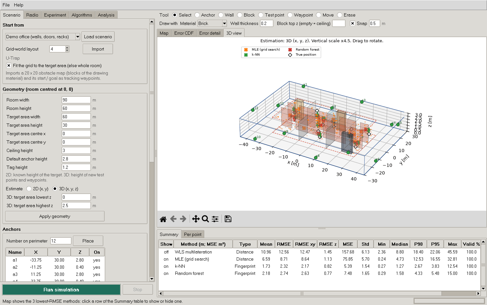

# Graphical interface

This guide describes the RSSILab application panel by panel: every field with its
default value, the tools of the map, the results and the files it writes. The models
behind the fields are explained in the other guides:

* [GUIDE_propagation.md](GUIDE_propagation.md): the channel model (Radio tab, obstacles);
* [GUIDE_algorithms.md](GUIDE_algorithms.md): the positioning methods and the error statistics (Algorithms tab, results);
* [GUIDE_tracking.md](GUIDE_tracking.md): routes, Kalman filter and particle filter (Experiment tab, Tracking);
* [GUIDE_custom_algorithms.md](GUIDE_custom_algorithms.md): testing your own algorithm;
* [GUIDE_python_api.md](GUIDE_python_api.md): scripting RSSILab.

Start the application with `python run_rssilab.py` from the RSSILab folder (the folder
of the repository), or with `rssilab` after `pip install .` (see the
[README](../README.md)).

## Contents

1. [Concepts](#1-concepts)
2. [The main window](#2-the-main-window)
3. [Scenario tab](#3-scenario-tab)
4. [Radio tab](#4-radio-tab)
5. [Experiment tab](#5-experiment-tab)
6. [Algorithms tab](#6-algorithms-tab)
7. [Running a simulation and reading the results](#7-running-a-simulation-and-reading-the-results)
8. [Analysis tab and files](#8-analysis-tab-and-files)
9. [Tips and troubleshooting](#9-tips-and-troubleshooting)

## 1. Concepts

**Coordinates.** Distances are in metres. The room is a rectangle centred at
(0, 0) in the horizontal plane; heights (z) are measured from the floor, up to the
ceiling height.

**Target area.** The rectangle (a box in 3D) where the target is expected to be.
Random test points, test grids, random-walk, circle and lawnmower routes, the
fingerprint survey and the grid of the grid-search estimator lie in it, and
estimates can be clipped to it. Test points and waypoints placed on the map may
also lie outside it.

**Anchors.** Fixed nodes with known positions (access points, beacons, gateways).
Each has its own height and can be switched off; switched-off anchors are ignored
everywhere. RSSILab simulates the RSS that the target receives from each anchor
(equivalently, that each anchor receives from the target).

**2D and 3D estimation.** In 2D the methods estimate (x, y) and the target height
is known (the *Tag height*). In 3D they estimate (x, y, z) inside the target volume.

**Readings, fixes and trials.** A *reading* is one RSS sample per anchor. A
*position fix* averages `samples per fix` readings (in dB) and produces one
estimate per method. In *Positioning* mode the target stands on test points and
each point gets `fixes per point` fixes; in *Tracking* mode the target walks along
a route at the chosen speed, readings are taken at the sample rate and every group
of `samples per fix` consecutive readings is one fix. A *trial* repeats the whole
experiment with new random readings (Monte Carlo); with *New shadowing realisation
at every trial* each trial also draws a new static shadowing field.

**Two families of positioning methods.**

* *Distance-based* methods use a path-loss model of the channel (the *estimator
  model*: P0, n, σ) to turn RSS into distances or into a likelihood.
* *Fingerprinting* methods learn the mapping from RSS to position from a simulated
  *survey* of the scenario: fingerprints recorded on a grid of reference points.

Both families can run in the same experiment, on exactly the same RSS.

## 2. The main window

* **Left panel**, five tabs: *Scenario*, *Radio*, *Experiment*, *Algorithms*,
  *Analysis*. Long panels scroll with the mouse wheel or the touchpad. Below the
  tabs: **Run simulation** and **Stop** (Stop interrupts a running simulation or
  dataset export).
* **Tool bar** above the map: the editing tools (*Select, Anchor, Wall, Block,
  Test point, Waypoint, Move, Erase*) and the drawing properties: *Material* (Brick
  at start), *Wall thickness* (0.2 m), *Block top z* (empty = ceiling) and *Snap*
  (on, 0.5 m step).
* **Plot tabs**: *Map*, *Error CDF*, *Error detail*, *3D view*. Each has the
  Matplotlib navigation bar (pan, zoom, save).
* **Results tables**: *Summary* and *Per point* (Positioning) or *Per trial*
  (Tracking).
* **Status bar**: hints for the current tool or the progress of a run, the cursor
  position on the map and a progress bar.

**Menus.** *File*: Open project, Save project, Export RSS dataset (CSV), Export
results per fix (CSV), Export statistics (CSV), Save current figure, Quit.
*Help*: Quick guide (a summary of this guide), User guide (online) (opens this guide
on GitHub), All guides (online) (the docs folder on GitHub), About RSSILab.

**Mouse and keyboard on the map.**

| Action | Effect |
|---|---|
| *Select* tool, click | selects an anchor or an obstacle (also in its table) |
| *Anchor* tool, click | adds an anchor at the *Default anchor height* |
| *Wall* tool, press-drag-release | draws a wall of the chosen material and thickness; walls within 7° of horizontal or vertical are straightened; walls shorter than 0.2 m are ignored |
| *Block* tool, press-drag-release | draws an axis-aligned block (desk, rack, pillar) from the floor to *Block top z* (empty = ceiling); blocks thinner than 0.1 m in x or y are ignored |
| *Test point* tool, click | adds a test point at the *Tag height*; selecting the tool switches the experiment to Positioning |
| *Waypoint* tool, click | appends a waypoint at the *Tag height*; selecting the tool switches the experiment to Tracking |
| *Move* tool, drag | moves anchors, test points, waypoints or obstacles |
| *Erase* tool, click | removes the nearest item |
| Right-click (any tool) | removes the nearest item |
| Delete or Backspace | removes the selected anchor or obstacle; with the focus on a table (anchors, obstacles, points) it removes the selected row of that table; in a text field it edits the text |
| Esc | cancels the wall or block being drawn |

With *Snap* on, clicks are rounded to the snap step. Test points and waypoints can
be picked only in their own mode.

## 3. Scenario tab

### Start from

* The **preset list** (first row) and **Load scenario**: *Reference 90 x 60 m, 12
  anchors* (the layout of the original RSSILab dataset: 60 x 30 m target area, 12
  anchors on the walls, five test points and a waypoint loop), *Demo office (walls,
  doors, racks)* (the same room with a corridor, rooms with doors, partitions of
  several materials, a metal rack, a furniture block and a wooden block) and *Small
  room 20 x 15 m* (4 anchors at the centres of the walls). Loading a preset replaces
  the whole scenario; RSSILab starts with the reference scenario.
* **Grid-world layout** (1-14) and **Import**: turns one of 14 obstacle maps on a
  20 x 20 grid (Open Field, The Wall, Smart City, U-Trap, Narrow Passage, Dual Path,
  Maze, Random Debris, Diagonal, The Room, The Bunker, The Spiral, Checkerboard,
  Mission Impossible) into blocks of the current drawing material, replacing the
  obstacles. The start and goal cells become two tracking waypoints and the
  experiment switches to Tracking with the *Waypoints* route.
  **Fit the grid to the target area (else whole room)** chooses where the grid is
  stretched.

### Geometry (room centred at 0, 0)

| Field | Default | Meaning |
|---|---|---|
| Room width, Room height | 90, 60 m | size of the room (walls at ±width/2, ±height/2) |
| Target area width, height | 60, 30 m | size of the target area |
| Target area centre x, y | 0, 0 m | centre of the target area (it must lie inside the room) |
| Ceiling height | 3 m | height of full-height walls and blocks without a top |
| Default anchor height | 0 m | height given to new anchors and by *All at default height* |
| Tag height | 0 m | 2D: the known target height; 3D: the height of new test points and waypoints |
| Estimate | 2D | 2D (x, y) with known height, or 3D (x, y, z) |
| 3D: target area lowest z, highest z | 0, 2.5 m | vertical extent of the target volume (3D only) |

**Apply geometry** checks the values (positive sizes, target area inside the room,
heights between floor and ceiling) and applies them; the fields are also applied
automatically when a simulation starts or a project is saved.

### Anchors

* **Number on perimeter** and **Place**: replaces the anchors with N anchors (at
  least 3) on the room walls: opposite walls get the same number, in proportion to
  their length, each anchor at the centre of an equal segment of its wall; with an
  odd N the remaining anchor goes to the top-left corner. N = 12 in the 90 x 60 m
  room gives the reference layout.
* The table lists name, x, y, z and whether the anchor is on. Select a row, edit
  **x, y, z** and press **Update**; **On/off** switches the anchor, **Delete** and
  **Clear all** remove anchors (the remaining ones are renamed a1, a2, ...).
* **Alternate height**, **All at default height**, **Alternate heights**: put every
  anchor at the default height, or alternate the default and the alternate height
  (odd anchors at the default, even ones at the alternate height). In 3D, anchors
  at different heights are what makes the target height observable.

### Obstacles

The table lists each obstacle with its type (*wall* or *rect* block), material, loss
at the current radio frequency (an asterisk marks a loss override) and height range.
Select a row, then set **Material**, **Loss override** (dB per crossing, empty = the
material table), **Bottom z** and **Top z** (empty = ceiling) and press **Apply to
selected**. **Delete** and **Clear all** remove obstacles.

Each obstacle crossed by the link between an anchor and the target attenuates it
once, and only if the link passes through the height range of the obstacle: a link
above a desk or a half wall is not attenuated. Walls and blocks also limit the
motion of the target (A* routes) and of the particle filter. The crossing rules and
the losses of the materials are in
[GUIDE_propagation.md](GUIDE_propagation.md#4-obstacles-the-multi-wall-model).

## 4. Radio tab

The model behind these fields, with the formulas, is described in
[GUIDE_propagation.md](GUIDE_propagation.md).

### Technology preset

**Load preset** fills all the radio fields; RSSILab starts with the *Legacy
log-normal model*. Presets: *Legacy log-normal model*, *Wi-Fi 2.4 GHz*, *Wi-Fi
5 GHz*, *Wi-Fi HaLow 868 MHz (802.11ah)*, *BLE 2.4 GHz*, *Zigbee / 802.15.4*,
*LoRa 868 MHz*, *UWB CH5 (RSS only)*. Their values are listed in
[GUIDE_propagation.md](GUIDE_propagation.md#11-technology-presets); they are
indicative starting points, not certified radio parameters.

### Link budget and path loss

| Field | Meaning |
|---|---|
| Frequency (GHz) | carrier frequency: free-space loss at d0 and material losses |
| TX power (dBm), Antenna gains - losses (dB) | used when P0 comes from free-space loss |
| P0 from free-space loss at d0 | on: P0 = TX power + gains − FSPL(d0, f); off: P0 is typed by hand |
| P0 (RSS at d0) (dBm) | mean RSS at the reference distance |
| Reference distance d0 (m) | reference distance of the log-distance model |
| Path-loss exponent n | slope of the log-distance model |

### Random components

| Field | Meaning |
|---|---|
| Shadowing std (dB) | standard deviation σ of the log-normal shadowing |
| Shadowing correlation (m) | 0: shadowing drawn independently for every reading (i.i.d.); > 0: a static Gaussian field per anchor with correlation exp(−r²/d_c²) (1/e at the correlation distance d_c), the same at every visit of a place |
| Fading | *None*; *Rayleigh* and *Rician*: power of a unit-mean channel, 10·log10\|h\|², drawn for every reading; *Legacy (Rayleigh amplitude in dB)*: σ·sqrt(−2 ln U), always positive (kept to reproduce the original dataset generator) |
| Rician K (dB) | ratio of line-of-sight to scattered power (Rician fading) |
| Legacy fading sigma | σ of the legacy fading term |

### Receiver

| Field | Meaning |
|---|---|
| Sensitivity (dBm) | readings below it are missing (NaN); −150 dBm or less switches the cut-off off |
| RSSI quantisation (dB) | readings are rounded to multiples of this step; 0 = off |
| Sample rate (Hz) | readings per anchor per second (sets the time between readings in Tracking) |
| Samples per fix | readings averaged (in dB) in each position fix; missing readings are skipped, a fix with none is missing |

The text under the panel shows the resulting P0, the mean and standard deviation of
one fading reading in dB, the standard deviation of the per-fix RSS (used by the
oracle calibration), the range at which the mean RSS of the log-distance model
reaches the sensitivity without walls (*unlimited* without cut-off) and the fix
rate. With legacy fading it also notes that the fading term is always positive
(biased) and that the oracle calibration adds its mean to P0.

## 5. Experiment tab

### Experiment type

*Positioning*: static target on test points. *Tracking*: target moving along a
route. The panel of the other mode is disabled.

### Positioning

| Field | Default | Meaning |
|---|---|---|
| Test points | Points on map | *Points on map* (added with the Test point tool or with *Random points to map*; their coordinates can be edited in the points table), *Random points* (uniform in the free target area, at least the *Clearance from obstacles* of the Tracking panel, 0.3 m, away from obstacles, drawn from the seed) or *Grid* (a grid over the target area from its corner, points inside obstacles removed) |
| Random points: how many | 10 | number of random points |
| Grid spacing | 2 m | spacing of the test grid |
| Fixes per point and trial | 10 | position fixes on each point in each trial |
| 3D: grid height | empty | height of the test grid in 3D (empty = tag height) |

**Preview points** shows the points that a run would use; **Random points to map**
copies the random points of the current seed into the editable test points (the
source becomes *Points on map*); **Clear points** removes the test points.

### Tracking

How routes are built, routed around obstacles and sampled is described in
[GUIDE_tracking.md](GUIDE_tracking.md).

| Field | Default | Meaning |
|---|---|---|
| Route | Waypoints (click on map) | *Waypoints* (the clicked waypoints in order), *Random walk* (random free cells joined by A* routes), *Circle* (an ellipse around the centre of the target area), *Lawnmower* (back-and-forth rows over the target area) |
| Speed | 1.0 m/s | constant target speed |
| Route around obstacles (A* planner) | on | waypoint and lawnmower legs avoid motion-blocking obstacles (the random walk always does, the circle never does) |
| A* grid resolution | 0.5 m | cell size of the planning grid |
| Clearance from obstacles | 0.3 m | distance kept from obstacles by the planner and by random test points |
| Random walk: waypoints | 6 | number of random waypoints |
| Circle: radius fraction | 0.8 | semi-axes as a fraction of the half sizes of the target area |
| Circle: laps | 1 | number of laps |
| Lawnmower: row spacing | 5 m | distance between rows |

Waypoints carry their own height in 3D (the height changes linearly along each leg);
circle and lawnmower routes are at the tag height. The ground truth of a fix is the
mean position of its readings and its time stamp is the middle of its averaging
window. **Preview route** draws the route that a run would follow and logs its
length and duration; **Clear waypoints** and **Reverse** edit the waypoints. The
log warns when a route crosses obstacles.

### Trials (Monte Carlo)

| Field | Default | Meaning |
|---|---|---|
| Trials | 1 | repetitions of the whole experiment with new random readings |
| Seed | 1 | seed of the experiment: the same seed reproduces the same results |
| New shadowing realisation at every trial | on | draws a new static shadowing field (and a new fingerprint survey) in every trial; off: one field for all the trials |

### Points of this experiment

The table lists the test points (Positioning) or the waypoints (Tracking) with
their x, y and z. Select a row, edit **x, y, z** and press **Update**; **Delete**
removes it; **All at tag height** sets the height of every point to the tag height.

## 6. Algorithms tab

What each method computes, with its formulas, is described in
[GUIDE_algorithms.md](GUIDE_algorithms.md); the filters in
[GUIDE_tracking.md](GUIDE_tracking.md).

### Positioning approach

*Distance-based*, *Fingerprinting* or *Both* (the default). Only the methods of the
chosen approach run; the panels of the other approach are disabled. With *Both* the
two families are compared on the same RSS. At start, WLS multilateration, NLS
multilateration, MLE (Levenberg-Marquardt), k-NN and Random forest are selected.
Methods added by plugins appear in the list of their family; when RSSILab runs from
its folder these include the two examples of `plugins/user_algorithms.py`
(*Example: strongest anchor* and *Example: nearest fingerprint*): edit or delete
that file to change them. How to add your own methods is explained in
[GUIDE_custom_algorithms.md](GUIDE_custom_algorithms.md).

### Distance-based methods

All these methods use the estimator model (see *Estimator calibration*).

| Method | In short |
|---|---|
| Min-Max | centre of the intersection of the boxes around the anchors |
| Weighted centroid | mean of the anchor positions weighted by (1/d)^g, over the k strongest anchors |
| Trilateration | exact solution with the 3 strongest non-aligned anchors (4 in 3D) |
| LLS multilateration | linear least squares on all received anchors |
| WLS multilateration | weighted linear least squares, weights ∝ 1/d⁴ |
| NLS multilateration | nonlinear least squares on the ranges (Levenberg-Marquardt) |
| MLE (Levenberg-Marquardt) | maximum likelihood on the RSS (Levenberg-Marquardt) |
| MLE (grid search) | maximum likelihood on a grid of candidate positions, optionally map-aware |

Trilateration, the multilateration methods and the Levenberg-Marquardt MLE need
D + 1 received anchors (3 in 2D, 4 in 3D). In 3D, when the anchors used in a fix are
all at one height, trilateration, LLS and WLS solve (x, y) from 3 anchors and take z
from the residual range, on the side of the target volume. When the received
anchors cannot fix the position (all on one line in 2D) the linear methods return
no estimate.

| Field | Default | Meaning |
|---|---|---|
| Weighted centroid: anchors k | 4 | strongest anchors used (0 = all) |
| Weighted centroid: exponent g | 1.0 | weight exponent |
| MLE grid resolution | 0.5 m | cell size of the MLE grid in x and y (also the likelihood grid of the particle filter) |
| Map-aware (walls in the MLE grid and PF) | on | the grid search and the particle filter include the wall losses in the model and keep estimates and particles out of obstacles |

### Fingerprinting methods

The fingerprinting models learn from a **survey** simulated in the same scenario,
with the same radio settings and the same shadowing realisation as the experiment:
reference points on a grid over the free target area (starting half a spacing from
its corner; on height layers in 3D), with *fingerprints per point* fingerprints
each, averaged like a position fix. Missing readings enter the models as
sensitivity − 5 dB. The survey is repeated, and the models trained again, for every
new shadowing realisation; the training time is reported separately from the time
per fix.

| Method | In short |
|---|---|
| k-NN | k nearest survey fingerprints in signal space, weighted average of their positions |
| WKNN (radio map) | weighted k-NN over the mean fingerprint of each reference point |
| Decision tree | regression tree (CART) from fingerprint to position |
| Random forest | average of bagged regression trees |
| Neural network (MLP) | multilayer perceptron with early stopping |

The decision tree, the random forest and the neural network need scikit-learn.

| Field | Default | Meaning |
|---|---|---|
| Survey grid spacing | 2.0 m | resolution of the survey (spacing of the reference points) |
| Fingerprints per point | 20 | fingerprints recorded at each reference point |
| Show the survey grid on the map | | draws the reference points (+) and logs their number |
| k-NN: neighbours K | 10 | neighbours among all the fingerprints |
| k-NN: weights 1/distance (else uniform) | on | weighting of the neighbours |
| WKNN: neighbours K | 4 | neighbours among the reference points |
| Decision tree: min. per leaf | 5 | minimum number of fingerprints in a leaf (larger = smoother) |
| Random forest: trees | 100 | number of trees |
| Neural network: hidden layers | 64, 64 | units of each hidden layer, separated by commas |

### All methods

| Field | Default | Meaning |
|---|---|---|
| 3D: vertical grid spacing | 0.5 m | height layers of the MLE grid, of the particle filter and of the survey (3D only) |
| Clip estimates to the target area | on | estimates (Kalman filter included) are clipped to the target area (volume in 3D) |

### Tracking

The filters run only in Tracking mode.

| Field | Default | Meaning |
|---|---|---|
| Kalman filter (constant velocity) on | on | adds *KF + method*: a constant-velocity Kalman filter on the fixes of the input method |
| KF input | MLE (Levenberg-Marquardt) | input method, from the chosen approach; it is computed even when it is not selected |
| KF acceleration std | 0.5 m/s² | process noise |
| KF measurement std | 0 (auto) | std of the input fixes; 0 = estimated in each trial from the fix-to-fix steps (robust MAD std divided by √2, at least 0.3 m; 3 m with fewer than 3 steps); the value of the first trial is reported in the log |
| Particle filter (path-loss likelihood) | off | adds *PF (RSS, map-aware)* (*PF (RSS)* when not map-aware): an SIR particle filter with constant-velocity motion and the RSS likelihood of the path-loss model; distance-based, so disabled with the Fingerprinting approach |
| PF particles | 1000 | number of particles (at least 50) |
| PF acceleration std | 0.5 m/s² | motion noise |
| PF position jitter | 0 (auto) | extra position noise per fix; 0 = 0.1 × speed × fix interval, at least 0.02 m |
| PF likelihood std | 0 (auto) | std of the RSS likelihood; 0 = the estimator σ (at least 1 dB) |
| PF random injection | 0.02 | fraction of particles redrawn at random in free space at every fix (at most 0.5) |

### Estimator calibration (distance-based)

What the distance-based methods and the particle filter believe about the channel.
*Oracle*: the true P0 and n, with the mean of the fading term in dB added to P0 (as a
calibration at d0 would) and the standard deviation of the per-fix RSS. *Manual*:
**P0 estimate**, **n estimate** and **RSS std estimate** as typed (−40 dBm, 4 and
3 dB at start), to study model mismatch; **Copy oracle values** fills them with the
oracle values. Fingerprinting does not use the model. See
[GUIDE_propagation.md](GUIDE_propagation.md#9-the-estimator-model).

## 7. Running a simulation and reading the results

**Run simulation** reads all the panels, runs the trials in the background (the
interface stays responsive, the progress bar and the status bar follow the run) and
shows the results. **Stop** interrupts the run. Errors in the parameters are shown
in a dialog before the run starts.

### Summary table

One row per method (the Kalman and particle filters included); the statistics are
defined in [GUIDE_algorithms.md](GUIDE_algorithms.md#6-error-statistics).

| Column | Meaning |
|---|---|
| Show | *on* if the method is drawn on the map and in the plots; click a row to toggle it. After a run, the three methods with the lowest RMSE are shown |
| Method, Type | name and family (Distance, Fingerprint, Tracking) |
| Mean, RMSE, MSE, Std, Min, Median, P90, P95, Max | statistics of the error e = \|estimate − truth\| over all trials and fixes, in m (MSE in m²); horizontal error in 2D, 3D error in 3D |
| RMSE xy, RMSE z | 3D only: horizontal and vertical parts of the RMSE |
| Valid % | share of fixes with an estimate (a method gives none when too few anchors are received) |
| ms/fix | computation time per fix (training excluded); for *KF + method* it also includes the time of its input method when that method is not selected (has no row of its own) |
| Train s | fingerprinting: training time per survey, in seconds (for *KF + method*, that of its input method when it is not selected) |

### Per point (Positioning)

Choose a method in **Method**. One row per test point with its coordinates, the mean
estimate, **Bias** = \|mean estimate − true position\|, **Spread** = RMS distance of
the estimates from their mean (so that MSE = Bias² + Spread²), the error statistics,
the number of fixes and Valid %. The last row (*All*) gives the statistics over all
points (bias and spread as RMS over the points). Bias reveals systematic errors
(model mismatch, walls, static shadowing, a coarse survey), spread the random ones.

### Per trial (Tracking)

One row per trial with the error statistics of that trial; with more than one trial
the last rows give the mean and the standard deviation of each statistic across
trials.

### Plots

* **Map**. Positioning: estimate clouds of the shown methods and, with up to 60
  test points, the mean estimate of each method on each point (×) joined to the
  true point and the 95% ellipse of the estimates. Tracking: ground truth (black)
  and the tracks of the first trial; the slider and **Play** move along time.
* **Error CDF**: empirical cumulative distribution of the error of the shown methods.
* **Error detail**. Positioning: RMSE per point of the shown methods and the
  distribution of the errors on each point for the method chosen in *Per point*
  (with more than 40 points: its bias and spread). Tracking: error vs time in the
  first trial and, with more trials, the RMSE of each trial.
* **3D view**: room, obstacles with their heights, anchors, test points or route and
  results; the vertical scale is exaggerated to keep heights readable; drag to
  rotate.

### Log (Analysis tab)

After every run the log reports the run time, the experiment size, the estimator
model, the lowest RMSE and notes such as: the survey size and the training times,
the share of readings below the sensitivity and of per-anchor fix averages with no
reading, the estimated Kalman measurement std (first trial), test points that
coincide with survey reference points (their fingerprinting errors are optimistic),
routes crossing obstacles, correlated-shadowing grids coarser than the correlation
distance, and 3D configurations with all anchors at one height.

## 8. Analysis tab and files

### Export RSS dataset (radio map, CSV)

Writes simulated readings on a grid over the target area at the tag height, with the
current scenario and radio settings (walls, materials, shadowing, fading,
quantisation, sensitivity):

| Field | Default | Meaning |
|---|---|---|
| Grid spacing | 1.0 m | spacing of the grid, from the corner of the target area |
| Samples per point | 100 | readings per grid point (one row each) |
| Seed | 1 | seed of the dataset |
| Skip grid points inside obstacles | off | drops the points inside motion-blocking obstacles |

Columns: `Coord_X, Coord_Y` (`Coord_Z` in 3D), then `Anc1_RSS ... AncN_RSS` for the
enabled anchors in table order; one row per reading; readings below the sensitivity
are written as `nan`. The file is written in the background (Stop removes the
incomplete file); exports above 5 million rows ask for confirmation. With the
reference scenario, the *Legacy log-normal model* preset, 1 m spacing and 10,000
samples per point the export reproduces the layout and channel of the original
RSSILab dataset.

### Export results per fix (CSV)

One row per trial and fix: `trial`, `fix`, `point` (Positioning, 1-based) or `t`
(Tracking, s), `x_true`, `y_true`, `z_true`, the averaged RSS of each enabled anchor
(`RSS_a1`, ...), then for each method `<method>_x`, `<method>_y` and `<method>_err`
(in 3D: `<method>_x`, `_y`, `_z`, `_err`, `_err_xy`, `_err_z`). Missing values are
`nan`.

### Export statistics (CSV)

Long format, one row per method and level: `level` (*overall*, *point* in
Positioning, *trial*), `method`, `family`, `id` (`all`, `P1`..., or the trial
number), the point coordinates and mean estimate, `bias` and `spread` (point
level), the statistics `n, valid, mean, mse, rmse, std, min, median, p90, p95, max,
rmse_xy, rmse_z`, and `ms_per_fix`, `train_s` (overall level).

### Save current figure

Saves the plot tab on screen as PNG, PDF or SVG (200 dpi).

### Projects

*File > Save project* writes a JSON file with the scenario (room, target area,
anchors, obstacles, test points, waypoints), the radio settings and every field of
the interface; *File > Open project* restores them. Projects that use names from
earlier versions of RSSILab (presets, methods) still open.

## 9. Tips and troubleshooting

* **The GUI does not start with Tk 9** (for example recent Homebrew Python):
  install matplotlib 3.10 or newer.
* **"... needs scikit-learn"**: install the requirements, `python -m pip install -r
  requirements.txt` (or `pip install scikit-learn`). The other methods work without
  it.
* **Long runs.** The cost of fingerprinting grows with the survey: reference points
  × fingerprints per point (× height layers in 3D), times the trials when the
  shadowing is redrawn at every trial. A coarser survey, fewer fingerprints, fewer
  trees or a smaller network shorten training; *New shadowing realisation at every
  trial* off trains once. For the distance-based methods the MLE grid resolution
  and the number of particles set the cost. Stop works at any time.
* **Optimistic fingerprinting results.** Test points that coincide with survey
  reference points are noted in the log; use random points or a test grid with the
  survey spacing.
* **3D accuracy.** RSS carries little information on height when the anchors are far
  away horizontally: put anchors at different heights (*Alternate heights*) and
  look at *RMSE z*.
* **Static vs i.i.d. shadowing.** With correlation 0 the shadowing changes at every
  reading and averages out; with a positive correlation distance it is the same at
  every visit of a place, does not average out, and can be learnt by a survey.
* **Your methods do not appear.** Plugins are loaded when the application starts:
  restart it after editing a file of `plugins/`, and check the log for loading
  errors (see [GUIDE_custom_algorithms.md](GUIDE_custom_algorithms.md#13-checklist-and-troubleshooting)).
