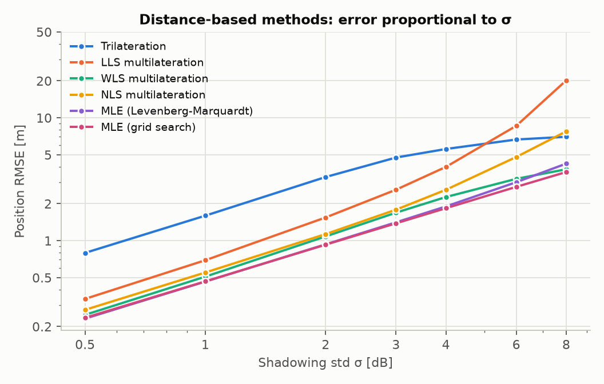
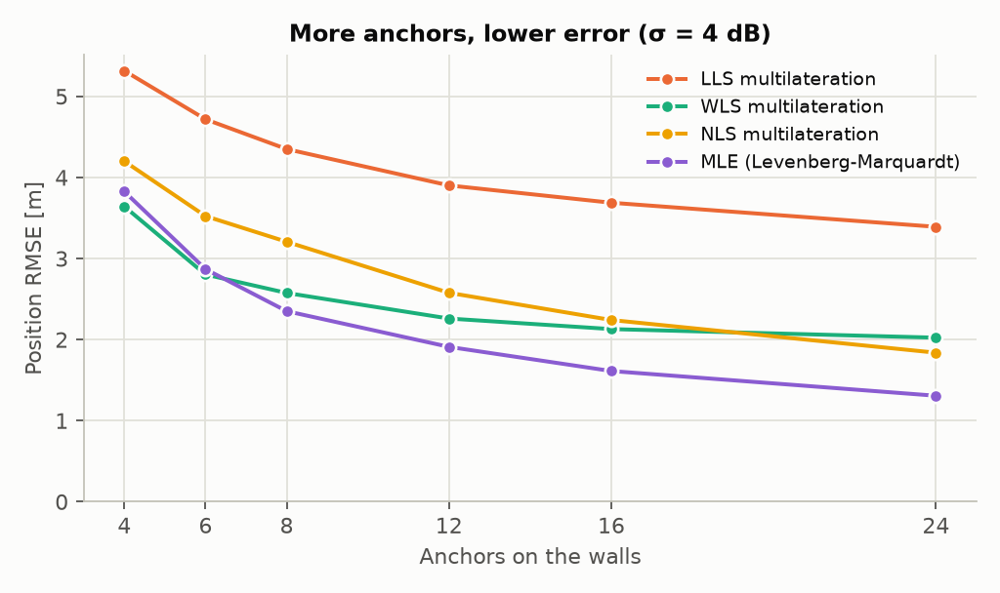
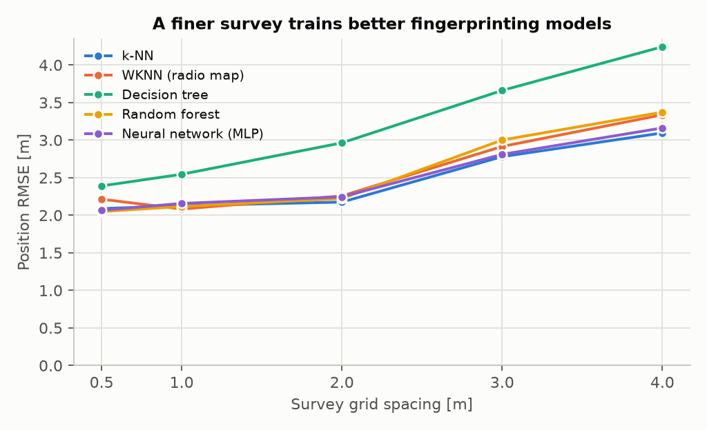
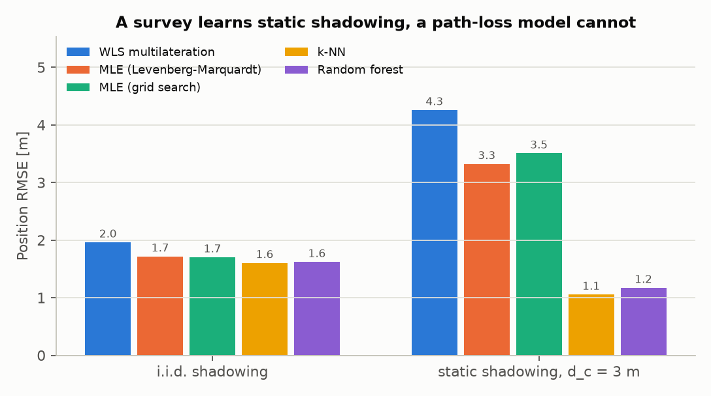
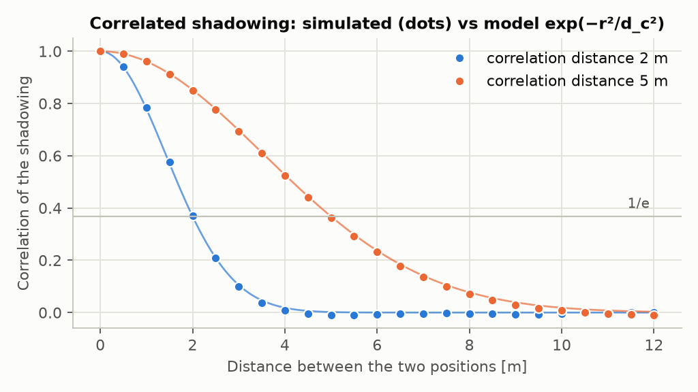

# Validation of RSSILab

A simulator for positioning research is useful only if its numbers can be trusted.
This page checks RSSILab against results that are known independently of the
code: exact solutions without noise, closed-form statistics of the channel, the
original dataset generator and the qualitative behaviour reported in the
RSS-positioning literature, for both families of methods (distance-based and
fingerprinting). The models are described in [GUIDE_propagation.md](GUIDE_propagation.md),
[GUIDE_algorithms.md](GUIDE_algorithms.md) and [GUIDE_tracking.md](GUIDE_tracking.md).

Everything here is produced by [`examples/validation_study.py`](../examples/validation_study.py)
with fixed seeds (`python examples/validation_study.py`, about a minute). Numbers
below were obtained with RSSILab 1.0.0, NumPy 2.5, scikit-learn 1.9 and Python 3.14;
other versions give the same results up to Monte Carlo noise.

## 1. Distance-based methods without noise

Reference room (90 x 60 m, no obstacles, 12 anchors on the walls), test grid every
2 m over the whole 60 x 30 m target area (496 points, including its edges, where the
three strongest anchors can lie on the same wall), no shadowing, no fading, oracle
calibration. In 3D the anchors alternate between 2.8 m and 0.3 m and the test points
are at 1.2 m.
Largest error over the points (m):

| method | 2D | 3D |
|---|---|---|
| Min-Max | 2.1e+00 | 2.4e+00 |
| Weighted centroid | 2.3e+01 | 2.3e+01 |
| Trilateration | 1.2e-13 | 1.3e-12 |
| LLS multilateration | 4.3e-14 | 8.5e-13 |
| WLS multilateration | 2.2e-13 | 8.4e-13 |
| NLS multilateration | 4.8e-08 | 6.4e-08 |
| MLE (Levenberg-Marquardt) | 7.9e-08 | 1.3e-07 |
| MLE (grid search) | 1.8e-01 | 1.2e+00 |

The linear solutions are exact to machine precision (trilateration skips the
strongest anchors that are aligned with each other, which would leave the
position undetermined), the iterative ones to their stopping tolerance. The grid
search (0.25 m cells) finds the right cell in 2D; in 3D the height is weakly
observable from these anchors, and the 0.125 m discretisation in x and y is enough
to move the optimum to another height layer. Min-Max and the weighted centroid
are biased by construction, even without noise.

## 2. Error vs shadowing

Open 20 x 20 m room, 12 anchors on the walls, 5 test points x 1000 fixes, i.i.d.
log-normal shadowing without fading, no clipping to the target area. RMSE (m):

| σ (dB) | Trilateration | LLS | WLS | NLS | MLE (LM) | MLE (grid) |
|---|---|---|---|---|---|---|
| 0.5 | 0.80 | 0.34 | 0.25 | 0.27 | 0.23 | 0.24 |
| 1 | 1.60 | 0.69 | 0.51 | 0.55 | 0.46 | 0.47 |
| 2 | 3.30 | 1.54 | 1.08 | 1.13 | 0.93 | 0.93 |
| 3 | 4.75 | 2.60 | 1.69 | 1.79 | 1.41 | 1.38 |
| 4 | 5.57 | 3.98 | 2.27 | 2.60 | 1.90 | 1.84 |
| 6 | 6.66 | 8.60 | 3.19 | 4.80 | 2.99 | 2.74 |
| 8 | 7.01 | 20.15 | 3.81 | 7.75 | 4.24 | 3.62 |

* At high SNR the error is proportional to σ: RMSE/σ is nearly constant between 0.5
  and 2 dB (0.46-0.47 m/dB for the maximum-likelihood estimators, 0.50-0.54 for WLS,
  0.55-0.57 for NLS, 0.67-0.77 for LLS).
* The ordering is the expected one: the maximum-likelihood estimators, which use the
  exact noise model, are the most accurate; weighting the linearised equations (WLS)
  or fitting the ranges directly (NLS) recovers most of the gap; unweighted LLS is
  worse and degrades quickly at large σ, where the far anchors give very noisy
  squared ranges; trilateration with only the 3 strongest anchors is the least
  accurate at high SNR but, using only near anchors, saturates at large σ.
* At large σ the iterative MLE departs from the grid search (local minima), while
  the exhaustive search, which also uses the target area as a prior, does not.

**Number of anchors** (σ = 4 dB, 500 fixes per point): every method improves with
more anchors.

| anchors | LLS | WLS | NLS | MLE (LM) |
|---|---|---|---|---|
| 4 | 5.32 | 3.64 | 4.20 | 3.83 |
| 6 | 4.72 | 2.80 | 3.52 | 2.87 |
| 8 | 4.35 | 2.57 | 3.21 | 2.35 |
| 12 | 3.90 | 2.26 | 2.58 | 1.91 |
| 16 | 3.69 | 2.13 | 2.24 | 1.61 |
| 24 | 3.39 | 2.02 | 1.84 | 1.31 |

## 3. Fingerprinting: resolution of the survey

Small 20 x 15 m room, 4 anchors, static shadowing (σ = 5 dB, correlation distance
3 m), Rayleigh fading, 5 readings per fix, 40 random points x 10 fixes, 3 trials
(a new shadowing realisation, survey and training in each). The survey records 20
fingerprints per reference point. RMSE (m) vs the survey grid spacing:

| spacing (m) | training fingerprints | k-NN | WKNN (radio map) | Decision tree | Random forest | Neural network (MLP) |
|---|---|---|---|---|---|---|
| 0.5 | 18,720 | 2.09 | 2.21 | 2.39 | 2.05 | 2.07 |
| 1 | 4,680 | 2.13 | 2.08 | 2.55 | 2.12 | 2.16 |
| 2 | 1,260 | 2.18 | 2.26 | 2.96 | 2.22 | 2.25 |
| 3 | 480 | 2.78 | 2.92 | 3.66 | 3.00 | 2.81 |
| 4 | 300 | 3.10 | 3.34 | 4.24 | 3.37 | 3.16 |

A finer survey trains better models, until the survey resolves the shadowing field
(spacing below its correlation distance); beyond that point the error is set by
the fading of the fixes. A single regression tree is the least accurate model;
k-NN, the random forest and the neural network are equivalent here.

Training time per survey (s), 2 CPU cores:

| model | 0.5 m | 1 m | 2 m | 3 m | 4 m |
|---|---|---|---|---|---|
| k-NN | 0.00 | 0.00 | 0.00 | 0.00 | 0.00 |
| WKNN (radio map) | 0.00 | 0.00 | 0.00 | 0.00 | 0.00 |
| Decision tree | 0.08 | 0.02 | 0.00 | 0.00 | 0.00 |
| Random forest | 2.15 | 0.63 | 0.30 | 0.26 | 0.22 |
| Neural network (MLP) | 4.35 | 1.41 | 0.68 | 0.57 | 0.24 |

## 4. Fingerprinting vs distance-based methods

Same room, σ = 5 dB without fading, 5 readings per fix, 40 random points x 20 fixes,
5 trials; survey every 1 m with 20 fingerprints per point. RMSE (m):

| shadowing | WLS multilateration | MLE (LM) | MLE (grid search) | k-NN | Random forest |
|---|---|---|---|---|---|
| i.i.d. per reading | 1.96 | 1.72 | 1.70 | 1.60 | 1.62 |
| static, d_c = 3 m | 4.26 | 3.32 | 3.51 | 1.05 | 1.17 |

With i.i.d. shadowing there is nothing a survey can learn and the two families are
equivalent. With static shadowing the same spot always sees the same deviation from
the path-loss law: the distance-based methods suffer from it (averaging readings
does not remove it), while the fingerprinting models learn it from the survey. This
is the qualitative result that motivates fingerprinting in real buildings.

## 5. Channel generators

**Fading.** Mean and standard deviation of one fading reading in dB, from 4·10⁶
Monte Carlo samples, against the exact values used by the oracle calibration
(Rayleigh: −10γ/ln 10 and π/√6 · 10/ln 10; Rician: numerical integration of the
density of ln|h|²; legacy: σ√(π/2) and σ√(2 − π/2)).

| model | mean dB (MC / exact) | std dB (MC / exact) |
|---|---|---|
| Rayleigh | −2.507 / −2.507 | 5.574 / 5.570 |
| Rician K = 3 dB | −1.546 / −1.551 | 4.371 / 4.375 |
| Rician K = 10 dB | −0.412 / −0.414 | 1.998 / 1.999 |
| Legacy, σ = 2 | +2.507 / +2.507 | 1.310 / 1.310 |

**Legacy model vs the original generator.** The *Legacy log-normal model* preset is
compared with an independent implementation of the original formula
Pr = −40 − 40·log10(d) + 3·N(0,1) + 2·√(−2 ln U), 2·10⁵ readings per distance.

| d (m) | mean dBm (reference / RSSILab) | std dB (reference / RSSILab) | two-sample KS distance |
|---|---|---|---|
| 2 | −49.536 / −49.533 | 3.264 / 3.272 | 0.0028 |
| 13.7 | −82.953 / −82.965 | 3.275 / 3.275 | 0.0043 |
| 40 | −101.582 / −101.584 | 3.276 / 3.271 | 0.0017 |

The distributions are indistinguishable (KS distance below 0.005 with 2·10⁵ samples).

**Spatially correlated shadowing.** Empirical correlation between the shadowing at
two positions r metres apart (20 field realisations, σ = 4 dB), against the model
exp(−r²/d_c²). The marginal standard deviation is 4.02 dB (d_c = 2 m) and 3.95 dB
(d_c = 5 m) for σ = 4 dB; the correlation at r = d_c is 0.372 and 0.363 (model:
1/e = 0.368). The field is generated on a grid with 8 nodes per correlation
distance and rescaled by the variance of the bilinear interpolation, so its
standard deviation is σ everywhere; in very large target areas the grid becomes
coarser and RSSILab notes that correlations shorter than the grid spacing are
smoothed.

## 6. Tracking

Demo office, BLE preset (σ = 4 dB static shadowing, Rayleigh fading, −95 dBm
sensitivity), random walk, 10 trials, survey every 2 m with 20 fingerprints per point.

| method | RMSE (m) | median (m) | P90 (m) |
|---|---|---|---|
| MLE (Levenberg-Marquardt) | 15.94 | 9.12 | 28.54 |
| MLE (grid search), map-aware | 5.91 | 2.97 | 9.69 |
| k-NN | 2.80 | 1.00 | 4.41 |
| Random forest | 3.28 | 2.03 | 5.14 |
| KF + MLE (Levenberg-Marquardt) | 13.25 | 8.43 | 21.38 |
| PF (RSS, map-aware) | 4.48 | 2.49 | 7.35 |

Walls and missing readings make the plain path-loss inversion unreliable in this
building; the Kalman filter smooths it but cannot remove its bias. The map-aware
grid search and the particle filter, which know the walls (and, for the filter, the
motion constraints), bring the error down, and the fingerprinting models, whose
survey contains the walls and the static shadowing of the building, are the most
accurate.
